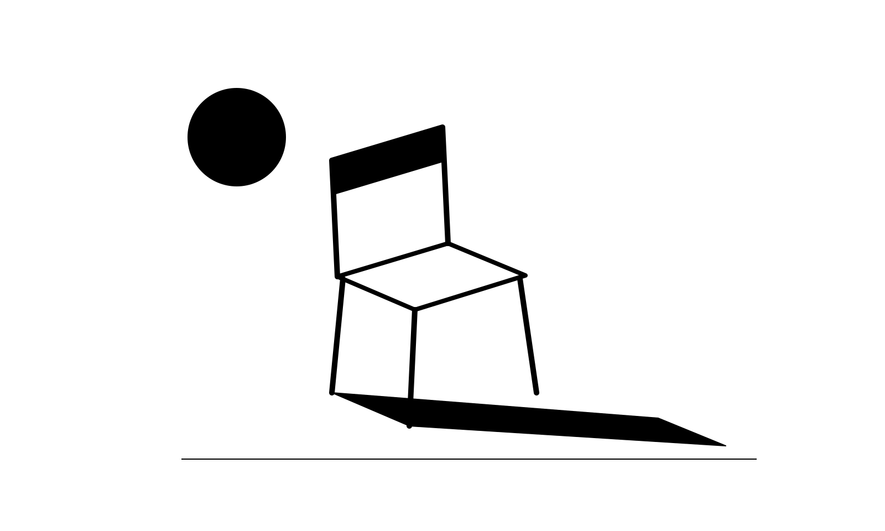

# Keep It or Change It

**One shared image. One daily decision. Keep it, or change it.**

A collaborative TRMNL image experiment. Scan the QR, tap **Keep it** or **Change it**, and leave. No game account, typing, or onboarding.



## Status

Version **0.1.0: private pilot**. The mobile voting page and shared state are implemented, with eight original monochrome artworks and four native TRMNL layouts.

[Open the owner-private pilot](https://keep-it-or-change-it.mchlkrt.chatgpt.site/) · [View the screen design preview](https://keep-it-or-change-it.mchlkrt.chatgpt.site/preview)

**The current pilot requires its owner's hosting sign-in and cannot be polled by TRMNL. A public HTTPS deployment is needed before the polling plugin can run.** No public recipe has been submitted. Native OG/X rendering still needs device review; the browser preview is illustrative.

## Rules

- Everyone sees the same image.
- One locked vote per browser per daily round.
- At **20:00 UTC**, a strict CHANGE majority advances to the next image.
- A KEEP majority, tie, or no votes keeps the current image.
- Current totals remain hidden until the round closes.
- There is no automatic retirement: an image can remain indefinitely.
- Age is counted in global daily rounds, starting at Day 1.

The browser identity uses an HttpOnly cookie. This is casual participation, not proof of one person: using another browser or clearing cookies creates another identity.

## Install or sync the TRMNL plugin

1. [Download the import ZIP](releases/Keep-It-or-Change-It-TRMNL-v0.1.0.zip?raw=true).
2. In TRMNL Private Plugins, choose **Import new** and select that ZIP.
3. Once a public voting service exists, set **Game server URL** to its HTTPS origin, without a trailing slash.
4. For GitHub Sync, connect this repository and leave **Folder in the repository** blank. The native files live in `src/`, matching TRMNL’s exported structure. Use **Import/Pull from GitHub** on the connected plugin before pressing Save in TRMNL; Save exports the editor’s current version back to GitHub.

The synced settings preserve the TRMNL-assigned plugin ID. The flat import ZIP remains available for creating a separate plugin; it is not needed to restore the already connected instance.

The plugin polls `/api/state` every 15 minutes. Full and half layouts include a QR code; the quarter view prioritises the image and age. All layouts use the standard TRMNL title bar. The API returns an image URL rather than base64 image bytes.

## Repository layout

| Location | Purpose |
|---|---|
| `src/settings.yml`, `src/*.liquid` | Canonical TRMNL sync settings and all four layouts |
| `.trmnlp.yml` | TRMNL-generated local preview configuration |
| `releases/` | Flat TRMNL import ZIP |
| `companion/app/` | Mobile page, voting API, and screen design preview |
| `companion/lib/game.ts` | Daily rounds and transactional settlement |
| `companion/db/`, `companion/drizzle/` | Schema and SQL migration |
| `companion/public/art/` | Eight original SVG and PNG artworks |
| `companion/test/` | Nine database-backed behavioural checks |

The companion source is a reusable copy of the private pilot. Its hosting manifest deliberately contains no existing Site identity. Uploading this repository does not redeploy or change access to the private pilot. The pilot's hosted source repository remains separate.

## Develop the companion app

Use Node 24 or newer with pnpm. Work from `companion/`; the retained Sites starter's own README explains the supported installation and hosting workflow.

```sh
cd companion
pnpm install --frozen-lockfile
node --test test/game.test.mjs
pnpm exec tsc --noEmit
pnpm run build
```

A D1 database bound as `DB` and the included SQL migration are required for the voting API. Local and hosted databases are separate. With Sites, registration supplies a new Site identity and publication applies the hosted migration. A build alone does not create a database or make voting available.

Decisions settle transactionally on the first request after the deadline. Inactive days implicitly KEEP; no scheduler is required. Screens update on their scheduled refresh. Repeated votes count once, stale rounds are rejected, and a database-clock check rejects requests delayed past the cutoff.

The starter advances through a finite eight-image pool, then cycles. A larger curated pool and an archive policy remain future work. It does not generate new images on demand.

## Validation

Nine logic/database tests, TypeScript checking, and the production build pass. Tests cover UTC/DST cutoff, decision rules, simultaneous initialisation, duplicate/conflicting submissions, image advancement, ties/no votes, delayed requests, inactive days, and pool wraparound. Browser automation and native TRMNL rendering were unavailable during the initial build.

## Next

- Review the artwork and mobile experience.
- Check native OG/X layouts and QR readability on devices.
- Deploy a public voting service and connect the plugin.
- Run a small pilot before recipe submission.

## License

MIT. Includes the original artwork and generator. Retained starter code and dependencies keep their own licenses.
